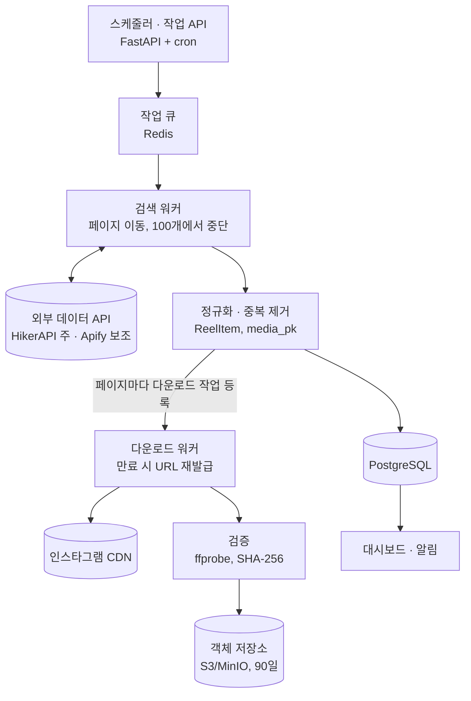

# PRD: 인스타그램 키워드 릴스 수집 시스템

| 항목 | 내용 |
| --- | --- |
| 문서 버전 | v1.0 |
| 작성일 | 2026-11-24 |
| 상태 | 초안 (법무 검토 전) |
| 원본 설계서 | 인스타그램 키워드 릴스 수집 시스템 설계서 |

---

## 1. 배경과 문제 정의

콘텐츠 기획과 트렌드 분석을 위해 특정 키워드의 인기 릴스를 반복적으로 찾아보고 있지만, 현재는 사람이 휴대폰에서 검색해 링크를 하나씩 복사하는 방식이다. 이 방식은 다음 문제가 있다.

- 키워드당 100개 수준의 릴스를 모으는 데 시간이 많이 든다.
- 조회수·좋아요 같은 지표가 수집 시점 기준으로 기록되지 않아 비교가 어렵다.
- 원본 게시물이 삭제되거나 비공개로 바뀌면 레퍼런스 영상을 다시 볼 수 없다.
- PC 웹 검색은 모바일 앱의 릴스 탭과 결과가 달라 대체 수단이 되지 못한다.

## 2. 목표와 비목표

### 2.1 목표

| ID | 목표 |
| --- | --- |
| G1 | 키워드 1개당 중복 없는 공개 릴스 100개를 자동 수집한다 |
| G2 | 메타데이터(캡션, 지표, 작성자, 오디오)와 영상 파일(MP4), 썸네일을 함께 저장한다 |
| G3 | 수집 순서가 모바일 앱 검색 → 릴스 탭 순위와 최대한 일치하도록 하고, 일치도를 수치로 측정한다 |
| G4 | 외부 데이터 제공사가 바뀌거나 장애가 나도 교체 가능한 구조로 만든다 |

### 2.2 비목표

- 로그인 계정 기반의 개인화된 검색 결과 재현
- 자체 인스타그램 계정 풀, 기기 위장, 차단 회피용 프록시 운영
- 비공개 계정 콘텐츠 수집
- 수집한 영상의 재배포, 재업로드, 광고 소재 활용
- 댓글 전문, 좋아요 누른 사용자 목록 수집

## 3. 대상 사용자

| 사용자 | 주요 사용 목적 |
| --- | --- |
| 콘텐츠 기획자 | 키워드별 인기 릴스의 훅, 포맷, 오디오를 레퍼런스로 검토 |
| 마케팅·트렌드 분석가 | 키워드별 지표 비교, 주간 추세 파악 |
| 시스템 운영자 | 수집 실행 관리, 실패 처리, 비용 관리 |

## 4. 사용자 스토리

| ID | 사용자 스토리 | 우선순위 |
| --- | --- | --- |
| US-01 | 기획자로서 키워드를 등록하면 모바일 릴스 탭 상위 100개를 순위대로 받고 싶다 | P0 |
| US-02 | 기획자로서 원본이 삭제돼도 저장된 영상을 다시 볼 수 있으면 좋겠다 | P0 |
| US-03 | 분석가로서 수집 결과를 CSV로 내려받아 지표를 비교하고 싶다 | P0 |
| US-04 | 분석가로서 같은 키워드를 주기적으로 수집해 순위 변화를 보고 싶다 | P1 |
| US-05 | 운영자로서 실행 실패 사유와 비용을 한 화면에서 보고 싶다 | P1 |
| US-06 | 운영자로서 실패율이나 비용이 기준을 넘으면 알림을 받고 싶다 | P1 |
| US-07 | 분석가로서 시스템 결과가 모바일 화면과 얼마나 일치하는지 주간 지표로 보고 싶다 | P1 |

## 5. 기능 요구사항

### 5.1 키워드·실행 관리

| ID | 요구사항 | 우선순위 |
| --- | --- | --- |
| FR-01 | 키워드를 등록·비활성화할 수 있다. 키워드별 목표 수량(기본 100)과 로케일(기본 ko_KR)을 설정한다 | P0 |
| FR-02 | 키워드 단위로 수집 실행을 수동 시작할 수 있다 | P0 |
| FR-03 | 키워드별 주기 실행(예: 매일, 매주)을 스케줄로 등록할 수 있다 | P1 |
| FR-04 | 실행 상태(queued, searching, downloading, done, partial, failed)와 진행 수량을 조회할 수 있다 | P0 |

### 5.2 검색 수집

| ID | 요구사항 | 우선순위 |
| --- | --- | --- |
| FR-10 | 주 제공사의 키워드 릴스 검색(HikerAPI `/v2/fbsearch/reels`)을 호출하고, `rank_token`, `reels_max_id`로 다음 페이지를 요청한다 | P0 |
| FR-11 | 중복 제거 후 고유 릴스가 목표 수량에 도달하면 검색을 멈춘다. 페이지 상한은 20이다 | P0 |
| FR-12 | 제공사 원본 응답을 페이지별로 저장한다(30일 보관) | P0 |
| FR-13 | 결과가 목표 수량 전에 끝나면 `search_exhausted`로 표시하고 해시태그 릴스(인기 → 최신)로 부족분을 채운다. 보충분은 출처를 구분해 저장한다 | P1 |
| FR-14 | 첫 페이지가 비면 민감 키워드 차단으로 보고 `screened`로 표시한 뒤 해시태그 경로로 수집한다 | P1 |
| FR-15 | 주 제공사 장애나 HTTP 410 발생 시 보조 제공사(Apify)로 전환할 수 있다 | P1 |

### 5.3 정규화·저장

| ID | 요구사항 | 우선순위 |
| --- | --- | --- |
| FR-20 | 제공사별 응답을 공통 형식(`ReelItem`)으로 변환한다 | P0 |
| FR-21 | `media_pk` 기준으로 중복을 제거하고, 같은 실행 안에서는 먼저 나온 순위를 유지한다 | P0 |
| FR-22 | 사진·캐러셀은 제외하고 릴스만 저장한다 | P0 |
| FR-23 | 릴스 메타데이터는 최신 지표로 갱신하고, 실행 시점 지표는 별도 스냅샷으로 보존한다 | P0 |

### 5.4 영상 다운로드

| ID | 요구사항 | 우선순위 |
| --- | --- | --- |
| FR-30 | 검색 페이지가 저장될 때마다 해당 릴스의 영상·썸네일 다운로드 작업을 즉시 큐에 넣는다 | P0 |
| FR-31 | 가장 높은 해상도 버전을 스트리밍으로 받고 SHA-256을 계산한다 | P0 |
| FR-32 | ffprobe로 재생 가능 여부, 길이, 해상도, 코덱을 검증한다 | P0 |
| FR-33 | 이미 저장된 릴스는 다시 받지 않는다 | P0 |
| FR-34 | 403·410 응답 또는 URL 수신 후 3시간 경과 시 미디어 정보 조회로 URL을 재발급받아 재시도한다 | P0 |
| FR-35 | 일반 오류는 지수 백오프(30초, 2분, 10분)로 최대 3회 재시도한다 | P0 |
| FR-36 | 저장 경로는 `reels/{media_pk}/video.mp4`, 썸네일은 같은 폴더에 둔다 | P0 |

### 5.5 조회·내보내기

| ID | 요구사항 | 우선순위 |
| --- | --- | --- |
| FR-40 | 실행별 결과를 순위, 링크, 지표, 작성자, 영상 저장 여부와 함께 CSV로 내보낸다 | P0 |
| FR-41 | 권한 있는 사용자는 저장된 영상을 내부 도구에서 재생할 수 있다 | P1 |
| FR-42 | 대시보드에서 실행 현황, 실패 사유, 비용, 일치도 추세를 본다 | P1 |

### 5.6 모바일 일치도 측정

| ID | 요구사항 | 우선순위 |
| --- | --- | --- |
| FR-50 | 테스트 휴대폰에서 기록한 릴스 탭 상위 30개 링크를 기준 데이터로 입력할 수 있다 | P1 |
| FR-51 | 기준 데이터와 같은 30분 안의 수집 결과로 Overlap@10, Overlap@30, RBO, 켄달 타우를 계산한다 | P1 |
| FR-52 | 해시태그 보충분과 차단 키워드 결과는 일치도 계산에서 제외한다 | P1 |

### 5.7 보관·삭제

| ID | 요구사항 | 우선순위 |
| --- | --- | --- |
| FR-60 | 영상 파일은 저장 후 90일이 지나면 자동 삭제한다. 연장은 승인 절차를 거친다 | P0 |
| FR-61 | 메타데이터는 1년, 원본 응답은 30일 보관 후 삭제한다 | P1 |
| FR-62 | 원본이 삭제·비공개 전환된 릴스는 `is_available = FALSE`로 표시한다 | P1 |

## 6. 비기능 요구사항

| ID | 항목 | 요구사항 |
| --- | --- | --- |
| NFR-01 | 처리 시간 | 키워드 1개 실행이 15분 안에 끝난다. 넘으면 `partial`로 종료 |
| NFR-02 | 동시성 | 검색 워커 키워드 2개 동시, 다운로드 워커 8개 동시(PoC 후 조정) |
| NFR-03 | 호출 간격 | 페이지 요청 사이 1~2초 간격 |
| NFR-04 | 완료 기준 | 고유 릴스 100개 + 영상 저장 95개 이상이면 `done` |
| NFR-05 | 멱등성 | 같은 키워드를 여러 번 실행해도 릴스 행이 중복 생성되지 않는다 |
| NFR-06 | 교체 가능성 | 제공사는 어댑터 인터페이스(`SearchProvider`)로만 접근한다 |
| NFR-07 | 보안 | API 키는 비밀 저장소에 보관. 영상 저장소는 분석 담당자만 접근, 외부 공유 링크 발급 금지 |
| NFR-08 | 관측성 | 모든 제공사 호출을 `api_usage`에 기록하고 일별 비용을 집계한다 |
| NFR-09 | 확장성 | 키워드 수백 개까지 VM 1대 + 관리형 DB로 운영 가능 |

## 7. 외부 의존성 (API 검증 결과, 2026-11-24 기준)

| 후보 | 키워드 릴스 검색 | 영상 URL | 비용 | 결정 |
| --- | --- | --- | --- | --- |
| HikerAPI `/v2/fbsearch/reels` | 가능. 인스타그램에 실시간 요청, 커서 기반 페이지 이동 | 미디어 정보에 포함(PoC에서 필드 확인) | 호출당 과금 | 주 제공사 후보 |
| Apify `memo23/instagram-reels-search-scraper` | 가능. `maxResultsPerQuery`로 수량 지정 | `videoUrl`, `thumbnailUrl` 제공 | 릴스 1개당 $0.0015~$0.001 | 보조 제공사 후보 |
| Meta Instagram Graph API | 해시태그 검색만 가능 | 일부 | 무료 | 요구사항 불충족 |
| Meta Content Library | 가능 | 연구 환경 안에서만 | 무료 | 연구기관·비영리만 자격 |

설계에 반영할 제약은 다음과 같다.

- 영상 CDN 링크는 몇 시간 안에 만료되므로 검색 직후 다운로드해야 한다.
- 다이어트·체형 관련 일부 키워드는 인스타그램이 검색 결과를 막아 API에서 빈 결과가 온다.
- Apify 무료 플랜은 실행당 처음 3개만 영상 링크를 주므로 유료 플랜이 필요하다.
- HikerAPI는 엔드포인트 버전이 여러 개이고 폐기 시 HTTP 410을 반환한다. 이전에 거론된 `/gql/topsearch`와 "2026년 11월 폐기" 내용은 공식 출처로 확인되지 않아 요구사항에 반영하지 않는다.
- 두 제공사 모두 결과의 지역·언어 기준이 한국 사용자와 다를 수 있다. 한국 지역 지정 옵션 유무는 PoC에서 확인한다.

## 8. 법적·정책 요구사항

이 시스템은 Meta가 허가하지 않은 경로로 데이터를 받으므로 착수 전에 법무 검토를 반드시 거친다. 아래는 위험 정리이며 법률 자문이 아니다.

| 영역 | 위험 | 요구사항 |
| --- | --- | --- |
| 인스타그램 약관 | Meta는 사전 허가 없는 자동 수집을 금지하고, 스크래핑이 감지된 계정을 제한할 수 있음 | 회사 인스타그램 계정을 수집에 연결하지 않는다. 로그인 없는 제공사만 사용한다 |
| 저작권 | 영상 저장은 저작물 복제에 해당 | 내부 분석·레퍼런스 용도로만 사용하고 재배포를 금지한다 |
| 개인정보 | 공개된 작성자 정보도 개인정보일 수 있음 | 수집 목적을 문서화하고 필요한 필드만 저장한다. 삭제·비공개 전환분을 주기적으로 정리한다 |
| 제공사 리스크 | 제공사가 법적 조치나 차단으로 중단될 수 있음 | 제공사 2곳을 교체 가능하게 유지한다 |

## 9. 성공 지표

| 지표 | 목표 | 측정 방법 |
| --- | --- | --- |
| 키워드당 고유 릴스 수 | 100개 (검색 소진·차단 키워드 제외) | `collection_runs.found_count` |
| 영상 저장률 | 95% 이상 | `downloaded_count / found_count` |
| 실행 성공률 | 90% 이상 | `done` 비율 |
| 모바일 일치도 | Overlap@30 60% 이상 (PoC 후 재설정) | 주간 측정 |
| 키워드당 비용 | PoC 실측값 이내 | `api_usage` 집계 |
| 수작업 시간 절감 | 키워드당 수집 시간 90% 이상 단축 | 도입 전후 비교 |

## 10. 시스템 개요



| 구성요소 | 기술 |
| --- | --- |
| 작업 API | Python FastAPI |
| 큐·워커 | Redis + Celery(또는 RQ), 검색 큐와 다운로드 큐 분리 |
| 메타데이터 DB | PostgreSQL 15 이상 |
| 영상 저장소 | AWS S3 또는 사내 MinIO, 수명 주기 규칙으로 자동 삭제 |
| 영상 검증 | ffprobe |
| 대시보드 | Metabase 또는 Grafana |
| 배포 | Docker Compose로 시작, 필요 시 Kubernetes |

## 11. 데이터 요구사항

| 테이블 | 역할 | 키 |
| --- | --- | --- |
| `keywords` | 수집 대상 키워드와 설정 | `id`, `keyword` 고유 |
| `collection_runs` | 키워드별 수집 실행 1회 | `id` |
| `raw_pages` | 제공사 원본 응답 | `id` |
| `authors` | 작성자 계정 | `ig_user_id` |
| `reels` | 릴스 메타데이터(최신 지표) | `media_pk` |
| `run_results` | 실행 × 릴스 × 순위, 시점 지표 | (`run_id`, `media_pk`) |
| `media_files` | 영상·썸네일 파일 상태 | `id`, (`media_pk`, `kind`) 고유 |
| `mobile_baselines` | 모바일 기준 화면 기록 | `id` |
| `api_usage` | 제공사 호출·비용 | `id` |

전체 DDL은 부록 A에 있다.

## 12. 릴리스 계획

| 단계 | 기간 | 산출물 | 통과 기준 |
| --- | --- | --- | --- |
| 0. 사전 준비 | 3일 | 법무 검토 결과, 제공사 계정, 측정 키워드 10개 | 법무 승인 |
| 1. PoC | 1주 | 두 제공사 응답 비교, 일치도·비용 실측 | 10개 키워드 모두 영상 URL 확보, Overlap@30 60% 이상인 제공사 1곳 이상 |
| 2. 핵심 파이프라인 | 2주 | DB, 어댑터, 검색·다운로드 워커, 작업 API, CSV 내보내기 (P0 전체) | 키워드 10개 `done` |
| 3. 운영 기능 | 1주 | 스케줄러, 자동 삭제, 대시보드, 알림 (P1) | 알림 동작 확인 |
| 4. 안정화 | 1주 | 키워드 50개 부하 테스트, 제공사 전환 테스트 | 성공률 90% 이상 |

단계별 공통 인수 조건은 다음과 같다.

- [ ] 같은 키워드를 두 번 실행해도 `reels`에 중복 행이 없다
- [ ] 저장된 영상이 재생되고 길이가 메타데이터와 1초 이내로 일치한다
- [ ] `api_usage` 합계가 제공사 청구 화면과 일치한다
- [ ] `delete_after`가 지난 파일이 실제로 삭제된다

## 13. 비용 추정

| 항목 | 단가 | 키워드 1개당 | 비고 |
| --- | --- | --- | --- |
| Apify 릴스 검색 | 릴스 1개당 $0.0015~$0.001 | 약 $0.10~$0.15 | Actor 가격표 기준 |
| HikerAPI 검색 + URL 재발급 | 호출당 과금, 최소 결제 $20부터 | 추정 10~20회 호출 | PoC에서 실측 |
| 영상 저장 | GB당 월 약 $0.025 (추정) | 약 0.8GB (릴스당 8MB 가정) | 길이·해상도에 따라 2~3배 차이 |
| 서버 | 소형 VM 1대 + 관리형 Postgres | 월 고정비 | |

## 14. 운영 지표와 알림

| 지표 | 정상 범위 | 알림 기준 |
| --- | --- | --- |
| 실행 성공률 | 90% 이상 | 80% 미만 |
| 영상 저장률 | 95% 이상 | 90% 미만 |
| 제공사 오류율 | 5% 미만 | 15% 이상, 또는 410 발생 |
| 키워드당 평균 비용 | PoC 실측값 | 실측값의 2배 초과 |
| Overlap@30 (주간) | 60% 이상 | 2주 연속 하락 |

## 15. 리스크와 대응

| 리스크 | 영향 | 가능성 | 대응 |
| --- | --- | --- | --- |
| 제공사 엔드포인트 폐기·변경 | 수집 중단 | 높음 | 시작 시 OpenAPI 헬스체크, 410 알림, 보조 제공사 전환 |
| 제공사 서비스 중단(법적 조치 등) | 수집 중단 | 중간 | 어댑터 구조로 교체, 대체 제공사 목록 유지 |
| 한국어 키워드 일치도 낮음 | 목표 G3 미달 | 중간 | PoC에서 지역 옵션 확인, 목표치 재설정 |
| 영상 URL 만료 | 저장률 하락 | 높음 | 즉시 다운로드, URL 재발급 |
| 약관·저작권 분쟁 | 법적 리스크 | 중간 | 법무 검토, 내부 용도 한정, 보관 기한 준수 |
| 비용 초과 | 예산 초과 | 낮음 | 비용 알림, 페이지 상한 |

## 16. 오픈 이슈

- [ ] 수집 키워드가 주로 한국어인가, 영어도 포함되는가 (제공사 선택에 영향)
- [ ] HikerAPI 응답의 영상 URL 필드명과 페이지당 릴스 수
- [ ] 제공사별 한국 지역·언어 지정 옵션 유무
- [ ] 영상 보관 기간 90일이 업무에 충분한가
- [ ] 저장 영상 재생 권한을 가질 사용자 범위

---

## 부록 A. DDL

```sql
CREATE TABLE keywords (
  id            BIGSERIAL PRIMARY KEY,
  keyword       TEXT NOT NULL UNIQUE,
  target_count  INT  NOT NULL DEFAULT 100,
  locale        TEXT NOT NULL DEFAULT 'ko_KR',
  is_active     BOOLEAN NOT NULL DEFAULT TRUE,
  created_at    TIMESTAMPTZ NOT NULL DEFAULT now()
);

CREATE TABLE collection_runs (
  id               BIGSERIAL PRIMARY KEY,
  keyword_id       BIGINT NOT NULL REFERENCES keywords(id),
  provider         TEXT NOT NULL,            -- 'hikerapi' | 'apify'
  status           TEXT NOT NULL,            -- queued|searching|downloading|done|partial|failed
  found_count      INT  NOT NULL DEFAULT 0,
  downloaded_count INT  NOT NULL DEFAULT 0,
  search_exhausted BOOLEAN NOT NULL DEFAULT FALSE,
  screened         BOOLEAN NOT NULL DEFAULT FALSE,
  started_at       TIMESTAMPTZ,
  finished_at      TIMESTAMPTZ,
  error            TEXT
);

CREATE TABLE raw_pages (
  id          BIGSERIAL PRIMARY KEY,
  run_id      BIGINT NOT NULL REFERENCES collection_runs(id),
  page_no     INT  NOT NULL,
  endpoint    TEXT NOT NULL,
  cursor_in   JSONB,
  payload     JSONB NOT NULL,
  fetched_at  TIMESTAMPTZ NOT NULL DEFAULT now()
);

CREATE TABLE authors (
  ig_user_id  TEXT PRIMARY KEY,
  username    TEXT NOT NULL,
  full_name   TEXT,
  is_verified BOOLEAN,
  updated_at  TIMESTAMPTZ NOT NULL DEFAULT now()
);

CREATE TABLE reels (
  media_pk      TEXT PRIMARY KEY,
  shortcode     TEXT NOT NULL UNIQUE,
  author_id     TEXT REFERENCES authors(ig_user_id),
  caption       TEXT,
  hashtags      TEXT[],
  taken_at      TIMESTAMPTZ,
  duration_sec  NUMERIC(6,2),
  play_count    BIGINT,
  like_count    BIGINT,
  comment_count BIGINT,
  share_count   BIGINT,
  music_title   TEXT,
  music_artist  TEXT,
  is_available  BOOLEAN NOT NULL DEFAULT TRUE,
  first_seen_at TIMESTAMPTZ NOT NULL DEFAULT now(),
  last_seen_at  TIMESTAMPTZ NOT NULL DEFAULT now()
);

CREATE TABLE run_results (
  run_id           BIGINT NOT NULL REFERENCES collection_runs(id),
  media_pk         TEXT   NOT NULL REFERENCES reels(media_pk),
  rank             INT    NOT NULL,
  page_no          INT    NOT NULL,
  source           TEXT   NOT NULL,          -- reels_serp | hashtag_top | hashtag_recent
  metrics_snapshot JSONB,
  PRIMARY KEY (run_id, media_pk),
  UNIQUE (run_id, rank)
);

CREATE TABLE media_files (
  id             BIGSERIAL PRIMARY KEY,
  media_pk       TEXT NOT NULL REFERENCES reels(media_pk),
  kind           TEXT NOT NULL,              -- video | thumbnail
  status         TEXT NOT NULL,              -- pending|downloading|stored|failed|expired_url|deleted
  source_url     TEXT,
  url_fetched_at TIMESTAMPTZ,
  storage_key    TEXT,
  sha256         CHAR(64),
  bytes          BIGINT,
  width          INT,
  height         INT,
  codec          TEXT,
  duration_sec   NUMERIC(6,2),
  attempts       INT NOT NULL DEFAULT 0,
  last_error     TEXT,
  stored_at      TIMESTAMPTZ,
  delete_after   TIMESTAMPTZ,
  UNIQUE (media_pk, kind)
);

CREATE TABLE mobile_baselines (
  id          BIGSERIAL PRIMARY KEY,
  keyword_id  BIGINT NOT NULL REFERENCES keywords(id),
  captured_at TIMESTAMPTZ NOT NULL,
  rank        INT NOT NULL,
  shortcode   TEXT NOT NULL,
  device_note TEXT
);

CREATE TABLE api_usage (
  id           BIGSERIAL PRIMARY KEY,
  run_id       BIGINT REFERENCES collection_runs(id),
  provider     TEXT NOT NULL,
  endpoint     TEXT NOT NULL,
  http_status  INT,
  billed_units NUMERIC(10,4),
  called_at    TIMESTAMPTZ NOT NULL DEFAULT now()
);

CREATE INDEX ON run_results (media_pk);
CREATE INDEX ON media_files (status) WHERE status IN ('pending','failed','expired_url');
CREATE INDEX ON media_files (delete_after);
CREATE INDEX ON reels (author_id);
CREATE INDEX ON mobile_baselines (keyword_id, captured_at);
```

## 부록 B. 제공사 어댑터 인터페이스

```python
@dataclass
class ReelItem:
    media_pk: str
    shortcode: str
    author_id: str
    username: str
    caption: str | None
    taken_at: datetime | None
    duration_sec: float | None
    play_count: int | None
    like_count: int | None
    comment_count: int | None
    video_url: str | None      # 가장 높은 해상도 버전
    thumbnail_url: str | None
    source: str                # reels_serp | hashtag_top | hashtag_recent

class SearchProvider(Protocol):
    name: str
    def search_reels(self, keyword: str, cursor: dict | None) -> tuple[list[ReelItem], dict | None]: ...
    def refresh_media(self, shortcode: str) -> ReelItem: ...   # 만료된 영상 URL 재발급
```

## 부록 C. 참고 자료

- HikerAPI `get_v2_fbsearch_reels`: https://glama.ai/mcp/servers/subzeroid/hikerapi-mcp/tools/get_v2_fbsearch_reels
- Apify Instagram Reels Search & Viral Finder: https://apify.com/memo23/instagram-reels-search-scraper
- instagrapi 검색 문서(fbsearch SERP 엔드포인트): https://subzeroid.github.io/instagrapi/3.2.13/usage-guide/search/
- Meta Content Library: https://transparency.meta.com/en-gb/researchtools/meta-content-library/
- Meta 자동 데이터 수집 정책: https://developers.facebook.com/documentation/development/terms-and-policies/automated-data-collection.md
- Instagram 데이터 스크래핑 안내: https://help.instagram.com/740480200552298
